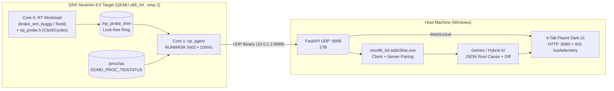

# NeutrinoPulse v2.0

**AI-Assisted Real-Time Telemetry, Symbol-Resolved Tracing & IPC Anomaly Copilot for QNX Neutrino RTOS 8.0**

Built for **QNX Global Hackathon 2026** (*Developer Tooling & Host Tools* • Bonus Tracks: *Best Use of QNX-specific Technologies* & *Best Codelab*).

---

## Overview

**NeutrinoPulse** bridges QNX Neutrino RTOS 8.0 runtime kernel telemetry with inline symbol resolution and AI-assisted root-cause analysis inside a high-density **4-Tab Fluent Dark Mode** host dashboard:

* **Zero-Jitter Core Isolation:** `np_agent` is pinned to **CPU Core 1** (`ThreadCtl(_NTO_TCTL_RUNMASK, 0x02)`), isolated from real-time C/C++ workloads running on **CPU Core 0** (`0x01`).
* **Deterministic Binary Telemetry:** Streams fixed-size **27-byte packed structs** (`<IIBHQQ`) over non-blocking UDP (`10.0.2.2:9999` via QEMU SLIRP) to avoid JSON formatting overhead on the target.
* **Lock-Free IPC Latency Probe (`np_probe.h`):** Measures `MsgSend()` round-trip latency in microseconds using `ClockCycles()` and captures exact application return addresses via `__builtin_return_address(0)` (avoiding `libc.so` `??:0` trap).
* **4-Tab Focused System Monitor UI (`frontend/index.html`):**
  1. **Performance:** Windows 11-inspired real-time IPC latency grid chart (`10,000 µs` budget threshold), metric selector, and QNX runtime specs.
  2. **Threads (`/proc/<pid>/as`):** High-density heatmap data grid with sortable priority, blocked streak, latency, and clickable `Caller IP`.
  3. **Kernel Timeline:** Scalable multi-TID scheduler state swimlane (`RUNNING`, `READY`, `STATE_REPLY`, `RECEIVE`, `NANOSLEEP`) with `All TIDs` / `Blocked & Running Only` filters.
  4. **AI Copilot & Code Fix:** Automatic `ntox86_64-addr2line` client/server code pairing (`GET /api/symbol`), Gemini root-cause diagnosis (`POST /api/diagnose`), and copyable source diff patch.

---

## Architecture



---

## Project Structure

```text
.
├── target/                 # QNX 8.0 C target agent, probe header, & demo workloads
│   ├── np_protocol.h       # Shared 27-byte packed UDP contract & lock-free shm struct
│   ├── np_probe.h          # ClockCycles() + __builtin_return_address(0) probe
│   ├── np_agent.c          # Core-1 pinned /proc polling & UDP telemetry daemon
│   ├── brake_sim_core.h    # 3-thread Core-0 RT workload (Prio 10, 15, 25)
│   ├── brake_sim_buggy.c   # Priority Inversion via _NTO_CHF_FIXED_PRIORITY
│   ├── brake_sim_fixed.c   # Fixed via ChannelCreate(0) priority inheritance
│   ├── Makefile            # Cross-compile with qcc -Vgcc_ntox86_64 -g -no-pie
│   └── verify_milestone2.py
├── backend/                # Host Python FastAPI + UDP receiver + addr2line + Gemini
│   ├── main.py             # FastAPI app, UDP server, /api/symbol, /api/diagnose, WS
│   ├── telemetry.py        # 27-byte decoder & Z-Score/blocking anomaly detector
│   ├── resolver.py         # ntox86_64-addr2line bridge & client/server pairing
│   ├── ai_copilot.py       # Hybrid Gemini / LM Studio / fallback diagnosis engine
│   ├── run_backend.bat     # Starts uvicorn on http://127.0.0.1:8090 (UDP 9999)
│   └── test_milestone3.py  # Automated backend, symbol, & AI verification tests
├── frontend/
│   └── index.html          # 4-Tab Fluent Dark UI (Performance, Threads, Timeline, AI Fix)
├── CODELAB.md              # Step-by-step tutorial (Best Codelab Bonus Track)
├── LICENSE                 # MIT License
└── run_qemu.bat            # QNX 8.0 x86_64 QEMU launcher (-smp 2 + SLIRP)
```

---

## Quick Start (Build & Run)

### 1. Build QNX 8.0 Target Binaries
```cmd
cd target
build.bat
```
*(Or source `qnxsdp-env.bat` / `qnxsdp-env.sh` and run `make all` using `qcc -Vgcc_ntox86_64`).*

### 2. Boot QNX 8.0 in QEMU (2 Cores)
If you do not yet have a QNX 8.0 QEMU disk image, generate one with QNX SDP 8.0 (`mkqnximage`) using your own SSH public key:
```sh
ssh-keygen -t ed25519 -f qnx_qemu_ed25519 -N ""
mkqnximage --type=qemu --arch=x86_64 --ssh-ident=qnx_qemu_ed25519.pub --noprompt --build
```
Set `QNX_QEMU_DISK` (and optionally `QEMU_EXE`) to point to the generated `disk-qemu`, then launch:
```cmd
:: Windows
set QNX_QEMU_DISK=C:\path\to\output\disk-qemu
run_qemu.bat
```
```sh
# Linux / WSL
QNX_QEMU_DISK=/path/to/output/disk-qemu ./run_qemu.sh
```

### 3. Start Host Backend & Dashboard
```cmd
cd backend
python -m venv .venv
.venv\Scripts\pip install -r requirements.txt
copy .env.example .env
# Optionally add GEMINI_API_KEY inside .env (or use built-in deterministic fallback)
run_backend.bat
```
On Linux / WSL, create `.venv`, install `requirements.txt`, copy `.env.example` to `.env`, and run `./run_backend.sh`.
> **WSL2 Note:** If QEMU runs on the Windows host while the backend runs inside WSL2, QEMU SLIRP sends UDP `10.0.2.2:9999` to the Windows host interface; run both QEMU and the backend on the same OS (or use WSL2 mirrored networking) so UDP `9999` packets reach FastAPI cleanly.

Open **`http://127.0.0.1:8090/`** in your browser or VS Code Simple Browser.

### 4. Deploy & Run on QNX Target
Transfer `np_agent`, `brake_sim_buggy`, and `brake_sim_fixed` to `/tmp/` on QEMU and run:
```sh
scp -P 2222 -i qnx_qemu_ed25519 -o Ciphers=aes256-ctr -o MACs=hmac-sha2-256 \
  target/np_agent target/brake_sim_buggy target/brake_sim_fixed root@127.0.0.1:/tmp/
ssh -p 2222 -i qnx_qemu_ed25519 -o Ciphers=aes256-ctr -o MACs=hmac-sha2-256 root@127.0.0.1
```
Inside the QNX target shell:
```sh
chmod +x /tmp/np_agent /tmp/brake_sim_buggy /tmp/brake_sim_fixed
/tmp/np_agent 10.0.2.2 9999 &
/tmp/brake_sim_buggy
```
1. Watch the latency spike (`~65,533 µs`) on **Tab 1 (`Performance`)**, **Tab 2 (`Threads`)**, and **Tab 3 (`Kernel Timeline`)**.
2. Click **`✦ Diagnose with AI`** (or **`Inspect →`** on `TID 3`) to open **Tab 4 (`AI Copilot & Code Fix`)** and inspect the mapped source lines + `ChannelCreate(0)` patch.
3. Run `/tmp/brake_sim_fixed` and observe real-time determinism return (`< 10,000 µs`).

### 5. Run Automated Verification Tests
```cmd
cd backend
python test_milestone3.py
```

---

## Codelab Tutorial

Follow our full hands-on engineering walkthrough in **[CODELAB.md](./CODELAB.md)**:
> *Building a Zero-Jitter Real-Time Telemetry Agent & Fixing Priority Inversion in QNX Neutrino 8.0*

---

## Evidence of QNX 8.0 Use

* **QNX Neutrino Microkernel IPC & Thread Control:** `ChannelCreate(_NTO_CHF_FIXED_PRIORITY)`, `ChannelCreate(0)`, `MsgSend()`, `MsgReceive()`, `MsgReply()`, `ThreadCtl(_NTO_TCTL_RUNMASK, ...)`, `ClockCycles()`, and `SYSPAGE_ENTRY(qtime)->cycles_per_sec` (`target/np_probe.h`, `target/brake_sim_core.h`, `target/brake_sim_buggy.c`, `target/brake_sim_fixed.c`).
* **QNX Procfs Instrumentation:** `DCMD_PROC_TIDSTATUS`, `DCMD_PROC_CURTHREAD`, `DCMD_PROC_GETGREG`, and `sys/states.h` thread states (`target/np_agent.c`, `backend/telemetry.py`).
* **QNX SDP 8.0 Toolchain:** Cross-compiled with `qcc -Vgcc_ntox86_64 -g -fno-pie -no-pie` and symbol-resolved via `ntox86_64-addr2line` (`target/Makefile`, `backend/resolver.py`); ASLR/PIE binaries are also normalized automatically by `np_agent` via `DCMD_PROC_MAPDEBUG`.
* **Current Scope:** Designed for single-target process instrumentation (`/np_probe_shm`, up to 256 thread slots) per active monitoring session.
